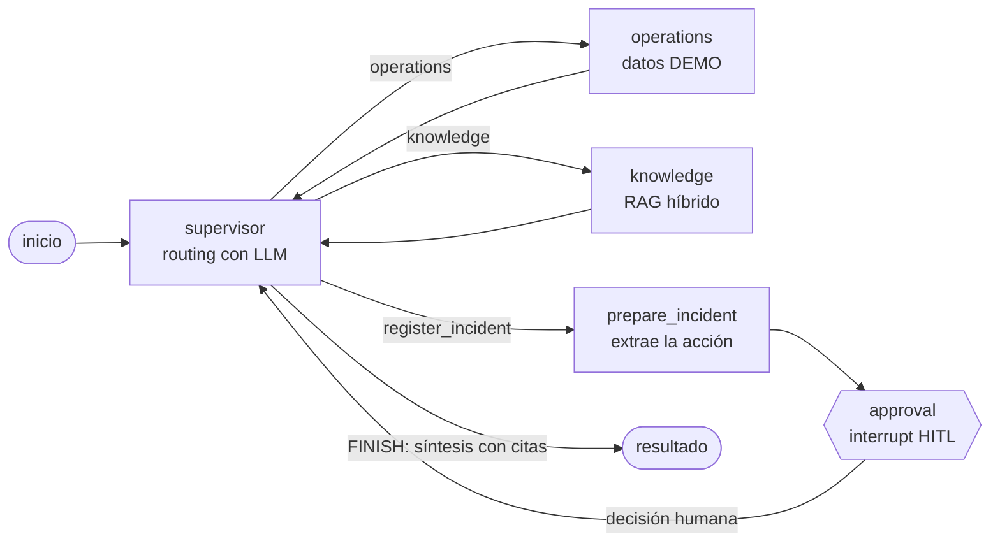

# AgroOps Intelligence System

Sistema de inteligencia operativa para establecimientos agropecuarios. Proyecto final del curso
**AI Engineering**. Un Supervisor (LangGraph) coordina agentes de **Operations** (datos) y
**Knowledge** (RAG sobre documentos), con una acción crítica que requiere **aprobación humana**.

Estado de validación: pruebas reales con OpenAI y trazas en LangSmith en
[docs/validacion_final.md](docs/validacion_final.md).

## Arquitectura



- **Cola y estado:** FastAPI encola el job en Redis y responde `202` de inmediato. Un worker
  asyncio procesa un job a la vez y guarda el estado en Redis (`PENDING → RUNNING → DONE / FAILED /
  WAITING_APPROVAL`).
- **Checkpointer:** LangGraph guarda cada paso en Redis Stack (`AsyncRedisSaver`, `thread_id = job_id`).
  Un job que espera aprobación sobrevive al reinicio del backend y se reanuda al decidir.
- **RAG:** ChromaDB con embeddings de OpenAI. Recuperación **híbrida**: ranking vectorial (con umbral de
  distancia) + BM25 sobre las palabras del texto, fusionados con RRF. Todo filtrado por
  `establishment_id`.
- **Sin tool calling:** los agentes son nodos del grafo. Sus entradas y salidas se validan con Pydantic.

## Requisitos del curso

| Requisito | Dónde está |
|---|---|
| RAG | `backend/app/rag/` (chunking, ingesta idempotente, retriever híbrido) |
| Agentes con Supervisor | `backend/app/agents/supervisor.py`, `operations.py`, `knowledge.py`, grafo en `graph/builder.py` |
| FastAPI | `backend/app/main.py`, `backend/app/api/` (`/tasks`, `/tasks/{id}/approve`, `/health`) |
| Redis | Cola de jobs, estado, incidencias (`services/job_service.py`, `services/incident_service.py`) |
| Checkpointer | `backend/app/infrastructure/checkpointer.py` (`AsyncRedisSaver`) |
| Pydantic | Schemas de API (`schemas/`), contratos de agentes (`schemas/agents.py`), salidas del LLM |
| Async | FastAPI, worker asyncio, clientes Redis y Chroma async, I/O bloqueante en `asyncio.to_thread` |
| Trazabilidad | LangSmith: `backend/app/observability/tracing.py`, reporte con `scripts/langsmith_report.py` |

## Ejecución con Docker Compose

Requisitos: Docker Desktop (o Docker Engine con Compose v2).

```bash
cp .env.example .env          # completar OPENAI_API_KEY y APPROVAL_API_KEY
docker compose up --build
```

Servicios: `backend` (puerto 8000), `redis` (Redis Stack, con AOF, sin puerto publicado), `chroma`
(puerto 8001 en el host). Al primer arranque se indexan los tres documentos DEMO del establecimiento
`demo` (solo si hay `OPENAI_API_KEY`; si ya están indexados no se vuelven a embeber).

Verificar:

```bash
curl localhost:8000/health
# Swagger: http://localhost:8000/docs
```

Consultar:

```bash
curl -X POST localhost:8000/tasks -H "Content-Type: application/json" \
  -d '{"user_input": "¿Qué maquinaria está fuera de servicio y qué tareas están pendientes?"}'
curl localhost:8000/tasks/<job_id>
```

`POST /tasks` acepta `establishment_id` (por defecto `demo`). Las búsquedas documentales siempre
se filtran por ese valor.

### Indexar documentos propios

Los archivos deben estar dentro del contenedor:

```bash
docker compose cp ./manual.pdf backend:/tmp/manual.pdf
docker compose exec backend python -m app.rag.ingest_cli --path /tmp/manual.pdf --establishment-id finca-1
```

Formatos: PDF, TXT y MD. Un directorio también es válido (`--path /tmp/docs/`).

### Human-in-the-loop (acciones críticas)

Pedir "registrá una incidencia: …" hace que el Supervisor enrute a `register_incident`. El grafo se
**pausa** (`interrupt`), el job queda en `WAITING_APPROVAL` con la acción propuesta, y nada cambia hasta
que un humano decide:

```bash
curl -X POST localhost:8000/tasks/<job_id>/approve -H "Content-Type: application/json" \
  -H "X-API-Key: $APPROVAL_API_KEY" -d '{"approve": true, "reason": "ok"}'
```

- Sin `APPROVAL_API_KEY` configurada el endpoint responde `503`; con clave incorrecta, `401`.
- Aprobar escribe la incidencia **una sola vez** (ID determinista) y `action_status` pasa a `APPLIED`.
- Rechazar no escribe nada (`REJECTED`). Una segunda decisión sobre el mismo job responde `409`.

## Variables de entorno

Todas están en [.env.example](.env.example). Solo `OPENAI_API_KEY` y `APPROVAL_API_KEY` requieren valor real.

| Variable | Default | Descripción |
|---|---|---|
| `OPENAI_API_KEY` | vacío | Clave de OpenAI. Sin ella los jobs fallan con un error claro. |
| `OPENAI_MODEL` | `gpt-4o-mini` | Modelo de routing, extracción y respuesta. |
| `EMBEDDING_MODEL` | `text-embedding-3-small` | Modelo de embeddings. Cambiarlo a otra dimensión exige reindexar. |
| `APPROVAL_API_KEY` | vacío | Clave del endpoint de aprobación (header `X-API-Key`). Vacía = deshabilitado. |
| `REDIS_URL` | `redis://redis:6379/0` | Redis Stack (requiere RedisJSON y RediSearch). |
| `CHROMA_HOST` / `CHROMA_PORT` / `CHROMA_COLLECTION` | `chroma` / `8000` / `agroops_knowledge` | Base vectorial. |
| `RAG_TOP_K` | `4` | Chunks por ranking (vectorial y por palabras) antes de fusionar. |
| `RAG_MAX_DISTANCE` | `0.75` | Distancia coseno máxima del ranking vectorial. |
| `RAG_CHUNK_SIZE` / `RAG_CHUNK_OVERLAP` | `800` / `120` | Tamaño y solapamiento de los chunks. |
| `GRAPH_MAX_STEPS` | `4` | Límite de pasos de agente por job. |
| `DEMO_ESTABLISHMENT_ID` | `demo` | Establecimiento de los datos DEMO. |
| `INGEST_DEMO_ON_STARTUP` | `true` | Indexar los documentos DEMO al arrancar. |
| `LANGSMITH_TRACING` | `false` | Trazas en LangSmith (requiere `LANGSMITH_API_KEY`). |
| `LANGSMITH_API_KEY` / `LANGSMITH_PROJECT` | vacío / `agroops-intelligence` | Proyecto de trazas. |

Nunca subir `.env` ni claves al repositorio. Las trazas guardan prompts y fragmentos de documentos
(no las claves).

## Observabilidad

Con `LANGSMITH_TRACING=true` cada job genera:

```
agroops.job                  (metadata: job_id, establishment_id, job_status, resumed)
└─ agroops.graph
   ├─ supervisor  └─ openai.chat (routing, síntesis)
   ├─ operations  └─ openai.chat
   ├─ knowledge   ├─ knowledge.retrieve (retriever) └─ openai.embeddings
   │              └─ openai.chat
   └─ prepare_incident / approval (HITL)
```

Un job que espera aprobación produce dos trazas (la inicial y la reanudación), agrupadas por `job_id`.

```bash
python scripts/langsmith_report.py <job_id>   # latencia, tokens y costo por nodo
```

Los valores que LangSmith no devuelve aparecen como `NO VERIFICADO`, nunca estimados.
Evidencia de la corrida final: [docs/evidencia/trazas/corrida_4/](docs/evidencia/trazas/corrida_4/).

## Pruebas

```bash
pip install -r backend/requirements-dev.txt
cd backend
pytest                                # unitarias: sin red ni OpenAI
```

Las pruebas unitarias usan fakes de Redis, LLM y Chroma (125 pasan).

Pruebas de integración contra Chroma real (sin OpenAI; embeddings locales). Usan una colección temporal que
se borra al terminar y **fallan si LangSmith está activo**:

```bash
docker compose up -d chroma
cd backend
AGROOPS_INTEGRATION=1 pytest tests/integration
```

Lint con Ruff (configuración en `ruff.toml`):

```bash
ruff check backend scripts
```

Pruebas de **crash real** (consumen pocas llamadas a OpenAI). Matan el contenedor del backend con SIGKILL
mientras hay jobs en curso, lo vuelven a levantar y verifican que no se pierdan jobs ni se dupliquen acciones:

```bash
docker compose up -d --build
python scripts/crash_recovery_check.py       # resultados en docs/evidencia/robustez/
```

Casos reales con OpenAI (consumen créditos; ejecutar solo para validar cambios de comportamiento):

```bash
python scripts/real_cases_check.py                                  # 8 casos
python scripts/real_cases_check.py --only K1_knowledge,B1_both      # subconjunto
```

Trazas de un job en LangSmith, con latencia, tokens y costo por nodo (solo lectura):

```bash
python scripts/langsmith_report.py <job_id>
```

Procedimiento, resultados y costos de cada corrida: [docs/validacion_final.md](docs/validacion_final.md).

## Resultados y limitaciones

Validación final con OpenAI real (8 casos de agentes y HITL), pruebas de crash real y costos
(≈ USD 0,01 en total): [docs/validacion_final.md](docs/validacion_final.md).

Limitaciones principales:
- El agente Knowledge a veces responde con un solo documento relevante, aunque otro también fue recuperado.
- La severidad que el LLM asigna a una incidencia puede variar entre corridas aun con `temperature=0`.
- Un job interrumpido por un crash queda `FAILED` (no se re-ejecuta, para no duplicar acciones); hay que reenviarlo.
- La búsqueda por palabras lee los chunks del establecimiento en cada consulta (no escala sin índice).
- Un job se procesa a la vez; no hay paralelismo entre jobs.
- `GET /tasks/{id}` no tiene autenticación; Redis y Chroma no usan contraseña dentro de la red de Compose.
- Operations usa datos DEMO estáticos.
